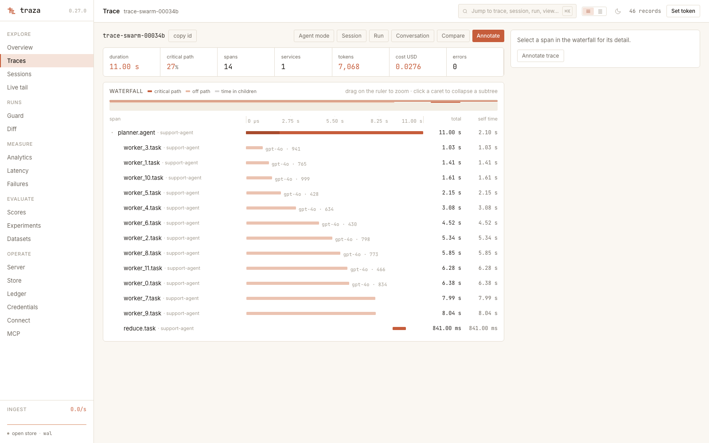

Traza
=====

**Traza is the flight recorder for AI agents that learns from every run and sees failure coming.** It records every model call and tool call your agents make, learns from all of them which paths end well, and says so — or stops the run before its next step — when a live run heads down a path that earlier runs mostly failed on. While a run is going you can watch it, nudge it or veto its next step. Afterwards you can see exactly what the model saw at any step, replay or fork the run with zero model calls, and prove what the store committed.

Nothing in it calls a model. Every prediction is counting over runs you already stored: a success rate with its 95% interval and the number of runs behind it, and every answer says how much history it stands on.

Underneath, Traza is a trace database for LLM and agent workloads. It runs as a single binary with no external database, no queue, and no coordinator: OpenTelemetry in, one directory on disk, and an HTTP API, a dashboard and an MCP endpoint out.

**Trace lookup at p95 1.3 ms and filtered search at p95 5.4 ms over a million spans. Stores 0.16–0.23x the bytes you send on service-trace and LLM-call shapes.** One process, one directory.

[](https://github.com/toshish/traza/actions/workflows/ci.yml)
[](https://crates.io/crates/traza)
[](LICENSE)

## Record

Point any OpenTelemetry exporter at it. Agents instrumented with OpenLLMetry, OpenInference or the OpenTelemetry GenAI conventions arrive with sessions, token and cost analytics, and step-by-step runs already populated. No attribute renaming, no mapping file.

```sh
export OTEL_EXPORTER_OTLP_ENDPOINT=http://localhost:8080
export OTEL_EXPORTER_OTLP_PROTOCOL=http/protobuf
export OTEL_EXPORTER_OTLP_COMPRESSION=gzip
python weather_agent.py                       # your instrumented agent

curl -s localhost:8080/v1/tapes/weather-7     # its model and tool calls in order, with what went in and came out
```

A run is a session (`session.id`, `gen_ai.conversation.id`, or OpenLLMetry's association property) or, without one, a trace. [Ingest](docs/guide/ingest.md) · [steps and runs](docs/llm-semantics.md#steps-and-runs)

**Coding agents, with no setup.** Claude Code and the Codex CLI already write every session to your disk. `traza-server import` turns those transcripts into runs — every model response a step, every tool call a step, every sub-agent an agent span — and `--watch` follows a live session within about a second. Then `blame` names the session, step, prompt and model that wrote a line of your code — here, in the [coding-agents demo](examples/coding-agents/README.md)'s project:

```sh
traza-server import claude-code --watch &     # every Claude Code session on this machine, then each new line
traza-server import codex                     # every Codex session
traza-server blame migrations/0007_order_coupon.sql:2
```

```
migrations/0007_order_coupon.sql:2  ALTER TABLE orders ADD COLUMN coupon_code TEXT;
  introduced 2026-10-18T10:20:40Z by Write in run 1c0a7e5b-2f4d-4e6a-8b9c-0d1e2f3a4b5c  [claude-code, claude-sonnet-4-5-20250929, step 33]
    prompt: Now record which coupon each order used.
```

The formats are undocumented, so unknown records are counted and skipped, never fatal; importing twice leaves one copy of each span. Blame sees edits made through editing tools whose arguments were recorded, not lines a shell command wrote. [Recorders and Agent Blame](docs/guide/recorders.md) · [limits](docs/guide/recorders.md#limits-honestly)

## Foresight

Every completed run of an agent is a path through its steps. The **Fate Map** counts them all — each branch with how often it ended well and a 95% Wilson interval — and flags as **fatal forks** the branches whose runs fail significantly more often than their siblings'. From the [foresight demo](examples/foresight/README.md), a support agent's 180 runs (trimmed: the demo also draws each interval against the base rate):

```
path                                    runs  success       95% CI
llm                                      180    54.4%   47.2–61.6%
├─ tool:search_orders › llm               90    76.7%   66.9–84.2%
│  ├─ tool:issue_refund › llm             60    90.0%   79.9–95.3%
│  └─ tool:issue_refund×2 › llm           30    50.0%   33.2–66.8%
│        FATAL FORK: 40.0 points below its siblings (90.0% of 60), Fisher p = 5.1e-05
├─ tool:search_orders×3-5 › llm           50    10.0%    4.3–21.4%
│     FATAL FORK: 61.5 points below its siblings (71.5% of 130), Fisher p = 2.2e-14
└─ tool:lookup_customer › llm › tool:escalate_ticket › llm
                                          40    60.0%   44.6–73.7%
```

A new run, `ticket-1042`, searches for an order twice and finds nothing. It has not failed — it has no outcome yet — but `GET /v1/fate/runs/ticket-1042` already reads `likely_failure`: *runs that took this path succeeded 5 of 50 times (10.0%, 95% CI 4.3–21.4%); the agent's overall success rate is 54%*. One fuse limit acts on that before the next step is paid for:

```sh
curl -X POST http://127.0.0.1:8080/v1/fuses/policies -d '{
  "name": "support", "match": {"service": "support-agent"},
  "limits": {"min_success_odds": 0.5}, "action": "stop"}'
curl -X POST http://127.0.0.1:8080/v1/fuses/check -d '{"run": "ticket-1042", "next": {"tool": "search_orders"}}'
# {…,"policy":"support","reasons":["foresight: runs that took this path and then called tool:search_orders succeeded 5 of 50 times (≤21.4%)"],"run":"ticket-1042",…,"verdict":"stop"}
```

The fuse compares the interval's upper bound, so it acts only when the history is strong enough to be confident — 0 of 3 runs never stops anything — and it is a prediction made again at every check, never latched. It reads a cached map and never builds one on the check. Every map scores its own predictions against how runs ended (`calibration`); read that before trusting a verdict. A fatal fork says where runs went wrong, not why. [Foresight](docs/guide/foresight.md) · [limitations](docs/guide/foresight.md#limitations)

## Guard

A run fuse holds a run to limits on cost, tokens, steps, repeated calls and failure streaks:

```sh
curl -X POST http://127.0.0.1:8080/v1/fuses/policies -d '{
  "name": "support", "match": {"service": "support-agent"},
  "limits": {"max_cost_usd": 2.0, "max_steps": 40, "max_repeats": 4, "max_error_streak": 3},
  "action": "stop"}'
```

When a `support-agent` run makes the same `search_orders` call a fourth time, the acknowledgement of that batch carries the verdict:

```
HTTP/1.1 200 OK
Traza-Fuse: stop; run=sess-7f3a
```

A span arrives when its step has ended, so that verdict is about the *next* step. An agent that asks before each step (`POST /v1/fuses/check`, from its harness, the [client libraries](docs/guide/clients.md#the-guard) or the [Claude Code hook pack](examples/claude-code/README.md)) hears the stop before the step runs instead. A kill switch stops any run at once, and a reset never refills a spent budget. A fuse acts between steps on recorded usage; it never interrupts a call in flight. [Run fuses](docs/guide/guard.md) · [limitations](docs/guide/guard.md#limitations)

## Steer

`GET /v1/runs/live` lists the runs working right now — current step, steps, spend, the guard's verdict and the run's foresight — and `/v1/runs/live/stream` sends a row as each changes; the dashboard's **Live** screen is built on it. A person can put words in front of a running agent, or veto its next step:

```sh
curl -X POST http://127.0.0.1:8080/v1/runs/sess-42/nudges \
  -d '{"message": "Hold refunds over $500 for a human.", "kind": "block"}'
```

The agent hears it at its next pre-call check — the same `POST /v1/fuses/check` the hook pack and the client libraries already make — once:

```
{…,"nudges":[{"id":"nd_162289fadd8bcc32","kind":"block","message":"Hold refunds over $500 for a human."}],"policy":"global","reasons":["Hold refunds over $500 for a human."],"run":"sess-42",…,"verdict":"stop"}
```

An `advice` nudge is words for the agent and leaves the verdict alone; a `block` refuses the run's checks for two seconds without tripping the fuse. Delivery is at most once and needs the agent to check. `GET /v1/runs/{run}/topology` draws how a run's agents handed work around, and `max_handoff_cycles` stops two agents bouncing a task between them. [Steer](docs/guide/steer.md) · [limitations](docs/guide/steer.md#limitations)

## X-Ray

What did the model actually see at step 29, where did each part of it come from, and why did the prompt cache break?

```sh
curl -s localhost:8080/v1/xray/<trace_id>/<span_id>   # one call's context as chunks, each traced to the step that put it there
curl -s localhost:8080/v1/cache/<run>                 # every model call against the previous one in its conversation
```

From the [coding-agents demo](examples/coding-agents/README.md), a Claude Code session that paused for sixteen minutes and was then compacted — the autopsy names and prices the break, and the X-Ray of the first call after the `/compact` lists the instructions it dropped:

```
step  agent          cause              gap  cache read  cache write  what changed
23    claude-code    ttl_expired    16m 03s           0       17,320  TTL passed: ~734 tokens re-processed, $0.0020 lost
30    claude-code    new_context     6m 43s           0        4,120  rewritten — the /compact

dropped since step 29: 20 chunks, ~968 tokens — 2 of them instructions the agent was given:
  step  0  Add percentage coupon codes to checkout. Never touch anything under migrations/ — those files run against production.
  step 23  Yes — cap coupons at 50% off.
```

Three steps later that session wrote the migration `blame` named above. Per-chunk tokens are estimates, staleness is a heuristic, and the provider's own cache rules are not modelled; cache losses are priced when the pricing file names a model's cache rates. [Context X-Ray and Cache Autopsy](docs/guide/xray.md) · [limits](docs/guide/xray.md#limits-stated-plainly)

## Replay

Re-run a recorded run through the agent's own code, with every model answer served from the recording:

```sh
curl -s -X POST localhost:8080/v1/replays -H "Authorization: Bearer $TRAZA_TOKEN" \
  -d '{"run": "weather-7"}'                   # answers its id and base_urls for both SDKs

export OPENAI_BASE_URL=http://localhost:8080/v1/replays/rp_ac879985abef9cba12bb342bdc3b8bd1/openai/v1
export OPENAI_API_KEY=$TRAZA_TOKEN
python weather_agent.py                       # zero model calls; ANTHROPIC_BASE_URL works the same way
```

Strict mode refuses a request that is not the recorded one (`409 replay_divergence`, naming the step) rather than answer a different question, and `GET /v1/diff?a=weather-7&b=weather-8` names the first step where two runs parted, and why. Tools still run live unless your harness takes their recorded results from `tools/next`, and streams are rebuilt from the stored text. On a server with no credentials, any non-empty API key works. [Replay](docs/guide/replay.md) · [limits](docs/guide/replay.md#limits-stated-plainly)

**Fork and rewind.** The same replay can serve a different answer at any step and then hand the agent to the real provider — what would it have done had the tool said sunshine?

```sh
curl -s -X POST localhost:8080/v1/replays \
  -d '{"run": "weather-7", "edits": [{"step": 1, "tool_result": {"forecast": "sun", "celsius": 24}}], "live_after": 1}'
```

After the live point every call answers `409 replay_live`, and the harness — `traza.fork(…)` in Python, `client.fork(…)` in TypeScript, or your own — switches to the real model; Traza never calls one. `GET /v1/forks?run=weather-7` lists the branches tried, each diffed against its parent. Recorded runs also become **tape tests**: `@pytest.mark.traza_tape("weather-7")` fails a test with the message, field and character where the agent left the recorded path, and `traza test` replays every run marked golden into a JUnit report. [Fork and rewind](docs/guide/fork.md) · [limits](docs/guide/fork.md#limits-stated-plainly)

## Prove

Every published generation, every settled erasure (as a SHA-256 of its subject, never the trace, span or session id) and every external anchor adds one entry to a SHA-256 hash chain:

```sh
curl -s localhost:8080/v1/ledger/verify
# {"chain_verified_at_ns":…,"entries":5,"generation":{…},"head":"34e6…","intact":true,"problems":[],…}

curl -s localhost:8080/v1/evidence -o evidence.json   # one document, one digest for a notary to sign
./traza-server verify --ledger --data-dir ./data      # offline, on a directory no server owns: exit 0 intact, 2 broken
```

A ten-line standard-library Python script recomputes every head. The chain has no secret in it, so history is tamper-evident only against an anchor, a head countersigned by a notary, that you keep outside the store; Traza stores anchors and never checks their signatures. [Ledger](docs/guide/ledger.md) · [what it proves, and what it does not](docs/guide/ledger.md#what-it-proves-and-what-it-does-not)

## See it run


*Replayed from real runs of the [demo tour](examples/README.md) — twelve scripted proofs, one
command each. Every number a demo prints is measured on your machine while you watch, each
script asserts its own claims, and CI runs all twelve. Clone, then pick one:*

```sh
./examples/foresight/run.sh        # a run called likely to fail before it has, and stopped before its next step
./examples/mission-control/run.sh  # live runs you steer from the dashboard: nudge, approve, kill, fork; until Ctrl-C
./examples/coding-agents/run.sh    # Claude Code and Codex imported: cost per sub-agent, a cache autopsy, blame
./examples/guard/run.sh            # a looping agent stopped between steps; a Claude Code session too
./examples/replay/run.sh           # record an agent run, replay it with zero model calls
./examples/prove/run.sh            # a hash chain recomputed with hashlib; one flipped byte, exit 2
./examples/swarm/run.sh            # a live agent cockpit in the dashboard, until Ctrl-C
./examples/crash/run.sh            # kill -9 mid-ingest; every acknowledged span survives
./examples/needle/run.sh           # a million spans in, one sentence found in milliseconds
./examples/incident/run.sh         # an agent diagnoses a runaway over MCP, promotes, diffs
./examples/vanish/run.sh           # tenant-precise erasure, and a receipt that names the backup
./examples/mcp-demo/run.sh         # the whole MCP tool surface, including everything it refuses
```

## Install

### Download

The server with the dashboard already built in. No Rust, no Node.

```sh
VERSION=0.28.0
PLATFORM=macos-aarch64          # or linux-x86_64, linux-aarch64

curl -LO https://github.com/toshish/traza/releases/download/v$VERSION/traza-$VERSION-$PLATFORM.tar.gz
tar xzf traza-$VERSION-$PLATFORM.tar.gz
cd traza-$VERSION-$PLATFORM
```

### Docker

```sh
docker run -p 8080:8080 -v traza-data:/data \
  -e TRAZA_TOKENS="rw:$(openssl rand -hex 16)" \
  ghcr.io/toshish/traza:latest
```

One container per volume at a time: a restarted container reclaims its own lock, so nothing stops a second one started on the same volume. Stop the old container before starting its replacement ([why](docs/operations/deployment.md#one-writer-per-data-directory)).

### Cargo

```sh
cargo install traza --locked --bin traza-server
```

Installs the server and API. The dashboard ships with the release archives, or build it from [`ui/`](ui/).

To embed the engine directly in your own process instead:

```sh
cargo add traza
```

### From source

```sh
git clone https://github.com/toshish/traza && cd traza
cargo build --release
(cd ui && npm ci && npm run build)
```

## Run

```sh
./traza-server
```

```
traza-server listening on 127.0.0.1:8080
traza-server: durability=wal — acknowledged writes are fsynced to the write-ahead log and recovered on restart
traza-server: profile=balanced — flush-spans=10000, wal-commit-window=off
traza-server: run fuses on — global policy: warn at {"max_repeats":12}
traza-server serving dashboard from /home/you/traza-0.28.0-linux-x86_64/ui
```

That is the whole setup. Data lands in `./data`, the dashboard is on <http://localhost:8080>.

### Common options

| Flag | Default | |
|---|---|---|
| `--data-dir DIR` | `./data` | All state. One writer process per directory. |
| `--host ADDR` | `127.0.0.1` | A non-loopback bind requires `TRAZA_TOKENS` or a runtime credential. |
| `--port PORT` | `8080` | `0` binds an ephemeral port and announces it. |
| `--durability MODE` | `wal` | `buffered`, `wal`, or `flushed`. Every response says which one answered. |
| `--profile NAME` | `balanced` | `throughput`, `balanced`, or `latency`. Sets the write-path knobs together. |
| `--ttl-seconds N` | off | Retention window for spans, annotations and payloads. |
| `--mcp` | off | Serve Model Context Protocol at `/v1/mcp`. |
| `--fuse-max-cost-usd F`, `--fuse-max-steps N`, … | warn at 12 repeats | The global [run fuse](docs/guide/guard.md) policy, for runs no tenant policy covers. `--fuse-action stop` makes it stop; `--no-fuses` turns fuses off. |
| `--ui-dir DIR` | beside the binary | Where the built dashboard lives. |
| `--restore DIR` | | Install a backup into `--data-dir`, then serve it. |
| `TRAZA_TOKENS` | unset | Bearer auth: `rw:` and `ro:` scoped, plus `admin:` for erasure, backups and `/v1/admin/*`. Bind a credential to one tenant with `rw@acme:token`. Credentials can also be minted and revoked at runtime. |

`--help` prints all fifty-six. The [configuration reference](docs/configuration.md) explains what each one costs.

### Examples

**Serving a team.** Named paths, an open bind address with auth, thirty days of retention, and the agent endpoint on:

```sh
export TRAZA_TOKENS="rw:$(openssl rand -hex 16),ro:$(openssl rand -hex 16)"

./traza-server \
  --data-dir /var/lib/traza \
  --host 0.0.0.0 \
  --ttl-seconds 2592000 \
  --mcp
```

**Closing an open store without a restart.** On a loopback start with no credentials, mint the first one. It must be an unbound `admin`, its token is in this response and nowhere else, and from this request on every call must authenticate, across restarts too. The rest are minted, listed and revoked under `/v1/admin/credentials` with that token:

```sh
curl -X POST http://localhost:8080/v1/admin/credentials \
  -H 'Content-Type: application/json' -d '{"scope":"admin","label":"root"}'
```

**Bulk backfill.** The `throughput` profile seals larger segments and lets more acknowledgements share one fsync, which is what you want when nothing is waiting on any single batch:

```sh
./traza-server --data-dir /var/lib/traza --profile throughput
```

**A client blocking on the acknowledgement.** The `latency` profile trades peak ingest for a materially better p95:

```sh
./traza-server --data-dir /var/lib/traza --profile latency
```

**Tests and CI.** `buffered` is the fastest mode and lossy by design, which is exactly right for a store you are about to throw away. Port `0` picks a free port and prints it, so parallel test runs do not collide:

```sh
./traza-server --data-dir "$(mktemp -d)" --port 0 --durability buffered
```

**Debugging an agent from your terminal.** Serve MCP, then point a client at it:

```sh
./traza-server --mcp
claude mcp add --transport http traza http://localhost:8080/v1/mcp
```

**Backing up a running server.** Pin and verify a consistent copy, take it, then release the pin. With auth on, a pin takes an unbound `admin` token, as erasure takes an `admin` one:

```sh
curl -X POST http://localhost:8080/v1/backups/nightly
cp -a ./data/pins/nightly /backups/traza-$(date +%F)
curl -X POST http://localhost:8080/v1/backups/nightly/release
```

**Restoring one.** Verified before anything is swapped, then served:

```sh
./traza-server --data-dir /var/lib/traza --restore /backups/traza-2026-08-10
```

**Erasing a session, and proving it.** Deletion by trace, span, session, tenant or payload, published at a checkpoint; the receipt re-checks every domain by name:

```sh
curl -X POST http://localhost:8080/v1/erasures \
  -H 'Content-Type: application/json' \
  -d '{"subject": {"kind": "session", "session_id": "sess-42"}}'

curl http://localhost:8080/v1/erasures/1/verify
```

## Send a span

```sh
curl -X POST http://localhost:8080/v1/spans \
  -H 'Content-Type: application/json' \
  -d '[{
    "trace_id": "trace-1",
    "span_id": "span-1",
    "name": "charge",
    "service": "checkout",
    "start_time_unix_nano": 1700000000000000000,
    "end_time_unix_nano": 1700000000002500000,
    "status": "ok"
  }]'
```

```json
{"accepted":1,"durability":"wal"}
```

Or point an existing app at it with the OTLP exporter variables under [Record](#record). Both routes take gzip bodies, and a batch over an [admission cap](docs/configuration.md#server-flags) is refused whole with a `400` that names the cap and the span.

## What you get



**Fast reads.** Trace lookup at p95 1.28 ms and filtered search at p95 5.4 ms over a million spans. Full-text search across prompt text returns a selective term in 0.57 ms where scanning takes 485 ms.

**One process.** No metadata database, no column store, no lock service, no object store to configure. Run the binary against a data directory; no control plane is required.

**A small surface.** Three direct dependencies and thirteen packages in a default build (the rest of the lockfile belongs to the opt-in `object-storage` feature), and a 7.5 MB binary. HTTP, threading and file I/O are the standard library, gzip and Zstandard are the crate's own decoders, and the crate is `#![forbid(unsafe_code)]`.

**Agent telemetry as the workload.** Sessions, token and cost rollups, prompts and completions with large ones offloaded and deduplicated, evals and human feedback attached after the fact, live tail, and one-command dataset export.

**What changed, and did it hurt?** [`GET /v1/changes`](docs/guide/radar.md) reads an agent's runs and returns a ranked timeline of change points — a system prompt edit, a tool added, a model snapshot swapped behind its alias, a deploy, or behaviour that shifted with no configuration change — each with error rate, success rate, cost, steps and tool mix on both sides, p-values, and a verdict. Correlation in time, not cause, and it says when several things changed at once.

**Behaviour you can query like a regex.** [TQL](docs/guide/tql.md) matches shapes in a run's steps — `test[error] ..> edit[file~"(^|/)tests?/"] ..> test[not error]` finds a test edited until it passed — and nine built-in detectors (test tampering, give-up loops, hallucinated tools, edit thrash, agent ping-pong and more) run over a window and compare how the matching runs ended against the rest.

**A dashboard for all of it.** Live runs with their foresight and the controls to steer them, the Fate Map, X-Ray and the cache autopsy, change timelines, behaviour search, blame, fork from any step — beside traces, sessions, the guard, diffs, analytics and evals. Built into the release archives; [trace browser guide](docs/guide/trace-browser.md).

**An endpoint your agent can query.** `--mcp` serves Model Context Protocol from the same binary and port: twenty-four tools shaped like the questions people actually ask, twenty-two of them reads (a run's foresight, the runs live now, a run's agent topology, blame for a line, an X-Ray of one call, what changed, a behaviour search and a run's forks among them) and two writers that stay off until enabled, with stored span text confined as untrusted and results bounded for a context window.

**Durability you choose.** Three acknowledgement modes, and every response states which one answered it. The suite proves them by killing the process, not by asserting.

**Backup without stopping.** One call pins and verifies a consistent copy of spans, annotations and payload bytes together. Restore is one flag.

**Archive to object storage (preview).** Behind the default-off `object-storage` feature, `traza-object` publishes a verified pin to S3-compatible storage as an immutable snapshot — then queries it in place by verified range reads, restores it whole, or deletes it. Archives are explicit historical copies, not tiering: the live writer is untouched, and local retention never silently reaches a published snapshot. See [docs/operations/object-storage.md](docs/operations/object-storage.md).

**Deletion with a receipt.** Erase a trace, a session, a whole tenant, or one offloaded payload from every domain — buffer, log, segments, annotations, payload files, datasets — then prove it: `verify --erasure` re-checks each domain by name and reports the result of each, down to the pinned backup that still holds the bytes and the dataset example that carries a promoted copy.

**Tenants in the key, not bolted on.** Span identity is `(tenant, trace_id, span_id)`, so two customers sharing a trace id can never overwrite each other. A token bound with `rw@acme:token` writes and reads exactly one tenant on every surface; retention takes per-tenant windows; `GET /v1/tenants` accounts usage per tenant. Single-tenant stores write byte-identical files and notice nothing.

**Operable while it runs.** Credentials are minted, listed and revoked over HTTP and kept only as digests. Each tenant can carry monthly span and byte quotas, an ingest pause and its own retention, set without a restart; a batch over quota is refused with `429` and `Retry-After`, and `GET /v1/usage` reports what each tenant has sent. `/healthz` and `/readyz` answer an orchestrator without a credential. See [administration](docs/operations/administration.md).

**The eval loop is representable.** Promote failing production traces into an immutable, content-addressed dataset version — examples keep their own copies, so deleting the source trace cannot corrupt them — run the experiment with your own harness, record runs and scores against `(experiment, example, span)`, and read score distributions and experiment-over-experiment diffs back out. Identity and addressing only: no runner, no scorer library, and your workflow stays yours.

## Client libraries

Zero-dependency clients for the routes an agent harness calls (the pre-call guard with the nudges it delivers and the rest of the run fuses, replays and forks, diffs, recall, the ledger head and evidence packs), with tape-test helpers, the pytest-traza plugin and a `traza` command for golden runs, live in [`sdk/`](sdk/): `traza` for Python 3.9+, on the standard library alone, and `@trazadb/sdk` for TypeScript on Node 20+, Deno, Bun and edge runtimes. They install from this repository. They are not instrumentation: OpenTelemetry records the spans, and the clients ask the server about them. See [docs/guide/clients.md](docs/guide/clients.md).

## Performance

| | |
|---|---|
| Trace lookup, 1M spans | p95 **1.28 ms** |
| Filtered search, 1M spans | p95 **5.4 ms** |
| Content search, selective term | **0.57 ms** (485 ms scanning) |
| Sustained ingest, `wal` | **208,973 spans/s** *(v6-format run, 2026-07)* |
| Stored vs ingested, service traces | **0.23x** |
| Stored vs ingested, LLM calls | **0.16x** |
| Direct dependencies | **3** |

The performance and storage figures come from bundled benchmarks: HTTP ingest/query harnesses and the embedded-store content-search harness. Latency and storage harnesses assert the format's [acceptance gates](docs/segment-format.md#acceptance-gates). The sustained-ingest row is explicitly historical; current v8 canonical runs sustained 65,749–69,615 spans/s with concurrent compaction. Both ingest figures also predate two additions to the ingest path and have not been re-run since: the per-span admission pass of 0.27.0, which serializes every span once more to enforce the admission caps and charge usage ([capacity](docs/operations/capacity.md) says what is and is not known about its cost), and the behaviour path the run guard keeps for every live run since 0.28.0. The paired [v7 → v8 comparison](docs/benchmarks/storage-v8-comparison.md) measured 31–44% fewer bytes across three synthetic corpora and identical normalized exports across migration. These are workload-specific measurements, not customer capacity guarantees. Run `cargo run --release --bin bench` to reproduce the canonical benchmark.

## When not to use Traza

**You require native HA or shared object storage.** Traza currently uses a single writer and local storage; this release does not add replication, failover, or an object tier. Format v8 measured 0.23x the ingested bytes on service traces and 0.16x on LLM calls in the bundled synthetic corpora. Repeated large context can also benefit from content addressing: 3.1 GiB ingested became 2.5 MiB on the highly repetitive `pinned-context` corpus. These results do not establish comparative HA cost or compression against other databases. [Storage economics and limitations](docs/storage-comparison.md) explains the distinction.

**You need metrics and logs in the same system.** Traza stores traces and their analytics. That is the whole surface, on purpose.

**You need horizontal scale-out today.** Traza is single-node.

**You want a model to judge your runs.** Traza never calls one. Its foresight, detectors and change verdicts are counts and tests over your own history, so an agent with little history gets little foresight, and every answer says how many runs it stands on.

## Documentation

Everything is in **[docs/](docs/README.md)** — getting started, the HTTP API, LLM semantics, the MCP server, run fuses, foresight, steering, the coding-agent recorders and blame, the context X-Ray, the change radar, TQL, replay and forks, the ledger, the client libraries, deployment, administration, durability, backup and restore, capacity, and the engine internals. What changed in each release is in the [changelog](CHANGELOG.md).

## Contributing

See [CONTRIBUTING.md](CONTRIBUTING.md). Stable Rust is the only dependency, `./ci.sh` is the merge bar, and a new dependency needs a written reason.

## License

Copyright © 2026 Toshish Jawale. [Apache-2.0](LICENSE).
